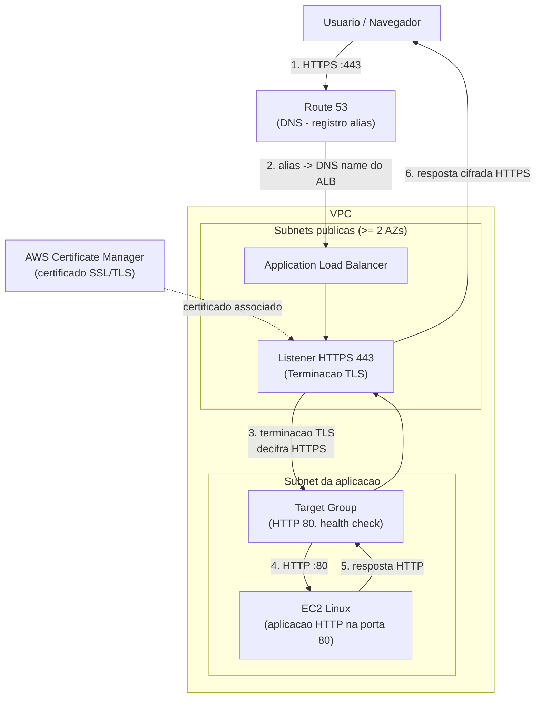
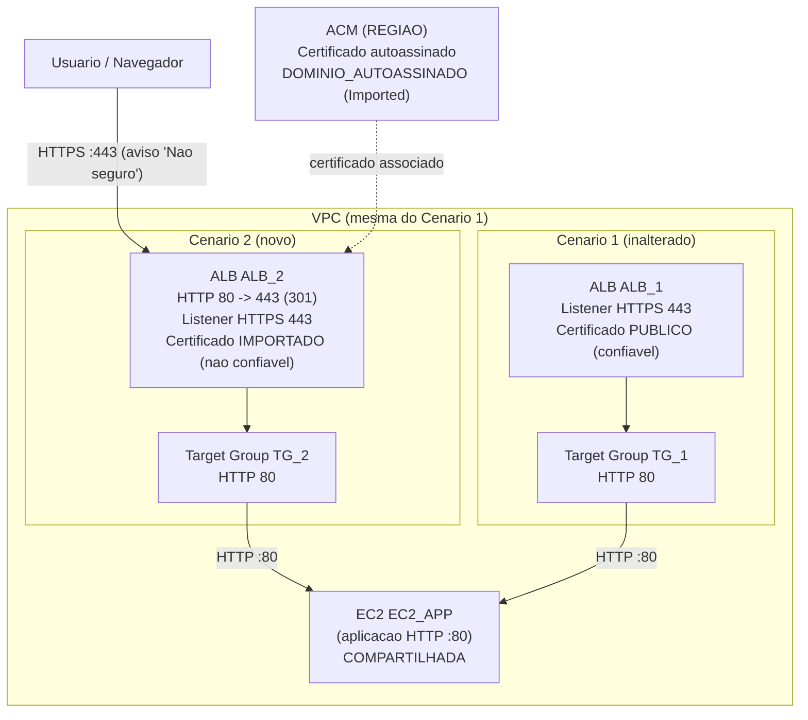

# AWS Certificate Manager SSL/TLS na Prática: Arquitetura

> ✅ **Arquitetura implantada e validada.** Os dois cenários descritos abaixo foram executados no Console AWS e confirmados no navegador. As evidências estão em [`TESTES.md`](TESTES.md). Os nomes de recursos usam **variáveis** definidas na tabela **Variáveis do laboratório** em [`IMPLANTACAO.md`](IMPLANTACAO.md).

## Visão geral

Este laboratório é **didático** e tem como objetivo ensinar, de forma guiada e reproduzível no **Console AWS em português (Brasil)**, como funcionam os certificados SSL/TLS na AWS. O foco está no uso do **AWS Certificate Manager (ACM)** em conjunto com um **Application Load Balancer (ALB)** que realiza a **terminação TLS** (encerramento da conexão HTTPS) e encaminha o tráfego já descriptografado como HTTP para uma instância **EC2 Linux**.

A arquitetura de referência cobre o caminho completo de uma requisição HTTPS: o usuário acessa o domínio pela porta 443; o **Route 53** resolve o nome e aponta para o ALB; o **Listener HTTPS 443** usa um certificado do ACM para encerrar a conexão TLS; e o **Target Group** encaminha o tráfego HTTP para a EC2 Linux que executa a aplicação web de exemplo.

Este laboratório reforça conceitos importantes de certificados na AWS, como: diferença entre certificados públicos, importados e privados; terminação TLS no balanceador de carga; exigência de o certificado estar na mesma Região do ALB; e a renovação automática de certificados públicos emitidos pelo ACM.

## Diagrama da arquitetura de referência

O diagrama abaixo representa a arquitetura de referência do laboratório, destacando o ALB como ponto de **terminação TLS**: o usuário acessa por HTTPS, o Route 53 resolve o nome para o ALB, o Listener HTTPS 443 encerra a conexão TLS usando o certificado do ACM e o tráfego é encaminhado como HTTP para a EC2 Linux registrada no Target Group.

## Como funciona o certificado digital (visão didática)

A figura abaixo resume o papel do certificado SSL/TLS no fluxo: o navegador acessa por HTTPS, o ponto de terminação TLS (o ALB, neste laboratório) apresenta o certificado do domínio e, após a validação, o tráfego segue cifrado até o balanceador, que então fala HTTP com o servidor da aplicação.

.png)

## Fluxo passo a passo da terminação TLS no ALB

O diagrama acima representa o caminho completo de uma requisição HTTPS. Cada passo numerado no diagrama corresponde a uma etapa do fluxo descrito abaixo, identificando os componentes envolvidos e suas relações:

1. **Usuário/Navegador → Route 53.** O usuário solicita `https://app.exemplo.com` na porta 443. O navegador precisa primeiro resolver o nome de domínio em um endereço de rede, então consulta o DNS.
2. **Route 53 → Application Load Balancer (ALB).** O Route 53 resolve o nome por meio de um registro **alias** que aponta diretamente para o **DNS name do ALB**. O registro alias é específico da AWS e resolve dinamicamente os IPs do balanceador, mesmo quando esses IPs mudam.
3. **Listener HTTPS 443 → terminação TLS (com o certificado do ACM).** A conexão chega ao **Listener HTTPS 443** do ALB. O ALB apresenta ao navegador o **certificado do ACM** associado ao listener e encerra a conexão TLS — essa é a **terminação TLS** (`Terminacao_TLS`). A partir desse ponto, dentro da fronteira do ALB, o tráfego está descriptografado. A relação entre ACM e listener aparece no diagrama como a associação `ACM -.-> Listener HTTPS 443`.
4. **ALB → EC2 Linux (via Target Group).** O ALB encaminha a requisição já descriptografada como **HTTP na porta 80** para a **EC2 Linux** registrada no **Target Group**. O ALB só encaminha para destinos cujo health check esteja `healthy`.
5. **EC2 Linux → ALB.** A EC2 processa a requisição e devolve a resposta HTTP ao ALB (retornando pelo Target Group).
6. **ALB → Usuário/Navegador.** O ALB re-cifra a resposta na conexão TLS já estabelecida com o navegador e a entrega ao usuário. Para o usuário, toda a comunicação externa permaneceu em HTTPS do início ao fim.

### Por que a terminação TLS acontece no ALB

Encerrar o TLS no ALB (e não na EC2) é uma decisão de design central deste laboratório, por três motivos:

- **Centralização do certificado:** o certificado vive em um único ponto — o **Listener HTTPS 443**. Não é preciso distribuir nem instalar o certificado em cada instância EC2.
- **Renovação automática sem tocar na EC2:** como o certificado público é emitido pelo ACM e associado ao listener, o ACM faz a **renovação automática** enquanto o registro de validação DNS permanecer válido. A EC2 nunca precisa ser alterada para renovar o certificado.
- **Aplicação simples na EC2:** a EC2 só precisa falar **HTTP** na porta 80. A complexidade de TLS (handshake, certificado, chave privada, política de segurança) fica concentrada no ALB.

O trecho **ALB → EC2** trafega como HTTP, mas **dentro da VPC** e protegido por **Security Groups** (a EC2 aceita a porta 80 apenas a partir do Security Group do ALB), de modo que esse tráfego não fica exposto à internet.

## Componentes AWS e decisões de configuração

A seguir, cada componente do diagrama com sua configuração relevante e o **motivo** (segurança/funcionamento) de cada decisão.

### AWS Certificate Manager (ACM)
- **Papel:** provisionar e armazenar o certificado SSL/TLS usado pelo Listener HTTPS do ALB.
- **Configuração relevante:** certificado (público ou importado) na **mesma Região do ALB**; validação por DNS para certificados públicos; estado alvo **Issued**.
- **Motivo:** o ACM integra-se nativamente ao ALB. Para certificados públicos emitidos por ele, há **renovação automática** enquanto o registro de validação DNS permanecer presente, o que elimina trabalho manual e reduz o risco de expiração.

.png)

### Application Load Balancer (ALB)
- **Papel:** ponto de entrada HTTPS público e local da terminação TLS.
- **Configuração relevante:** esquema **internet-facing**; em **pelo menos 2 subnets públicas em AZs distintas**; Security Group próprio; Listener HTTPS 443.
- **Motivo:** balanceador de camada 7 com integração direta ao ACM. Exigir 2 AZs é requisito do próprio ALB e aumenta a disponibilidade.

.png)

### Listener HTTPS 443
- **Papel:** encerra o TLS usando o certificado do ACM e encaminha para o Target Group.
- **Configuração relevante:** protocolo **HTTPS**, porta **443**, certificado padrão do ACM, política de segurança TLS recomendada, ação padrão **forward** para o Target Group.
- **Motivo:** é o ponto em que o certificado é efetivamente usado. Trocar o certificado aqui é exatamente o que os testes positivos de "alteração de certificado" validam.

### Target Group
- **Papel:** agrupa os destinos (a EC2) e executa os health checks.
- **Configuração relevante:** tipo **instance**, protocolo **HTTP**, porta **80**, health check em caminho HTTP (por exemplo, `/`), estado alvo **healthy**.
- **Motivo:** o ALB só encaminha tráfego para destinos saudáveis. O health check é o sinal observável de que a EC2 está apta a receber requisições.

.png)

### EC2 Linux
- **Papel:** executa a aplicação web de exemplo que responde HTTP na porta 80 com uma página HTML estática.
- **Configuração relevante:** AMI Linux; Security Group que aceita a porta 80 **apenas** do Security Group do ALB; servidor web simples servindo HTML.
- **Motivo:** mantém a aplicação simples (só HTTP), reforçando que a segurança TLS vive no ALB. A instância pode ser **reutilizada** de outro laboratório quando aplicável.

.png)

### Route 53
- **Papel:** DNS do domínio — validação DNS do ACM e apontamento do domínio ao ALB.
- **Configuração relevante:** **Hosted Zone** do domínio; registro **CNAME de validação** fornecido pelo ACM; registro **alias** apontando o domínio para o DNS name do ALB.
- **Motivo:** o registro alias para o ALB é gratuito e resolve dinamicamente os IPs do balanceador. Manter o CNAME de validação presente é o que habilita a renovação automática do certificado público.

.png)

### Security Groups
- **SG do ALB:** entrada **443 (HTTPS)** de `0.0.0.0/0` (público); saída na **porta 80** para o SG da EC2.
- **SG da EC2:** entrada **80 (HTTP)** **somente** a partir do SG do ALB (por **referência de grupo**, não por CIDR aberto).
- **Motivo:** aplica o princípio do menor privilégio na rede. A EC2 nunca é exposta diretamente à internet; apenas o ALB fala com ela, e somente na porta necessária. A referência de grupo mantém a regra válida mesmo que os IPs mudem.

.png)

### VPC e Subnets (base de rede)
- **Papel:** rede onde o ALB e a EC2 operam.
- **Configuração relevante:** VPC com **pelo menos 2 subnets públicas** em AZs distintas (exigência do ALB); a EC2 em subnet alcançável pelo ALB.
- **Motivo:** requisito estrutural do ALB. O laboratório usa a VPC padrão ou uma existente para não criar recursos extras.

## Arquitetura do Cenário 2 — certificado autoassinado importado (segundo ALB)

O **Cenário 2** usa uma segunda arquitetura, **independente** da do Cenário 1, para demonstrar um **certificado autoassinado importado** no ACM — **sem alterar** o Cenário 1. A diferença central é que esta arquitetura tem um **segundo ALB** (`<ALB_2>`) e um **segundo Target Group** (`<TG_2>`), mas **compartilha a mesma EC2** (`<EC2_APP>`) e o mesmo **Security Group do ALB** (`<SG_ALB>`).

> As variáveis (`<ALB_1>`, `<TG_1>`, `<EC2_APP>`, `<DOMINIO_PUBLICO>`, etc.) estão definidas na tabela **Variáveis do laboratório** em [`IMPLANTACAO.md`](IMPLANTACAO.md). Substitua cada placeholder pelos seus próprios valores.

**Pontos-chave desta arquitetura:**

- **Dois ALBs e dois Target Groups independentes.** Cada ALB tem o seu próprio Target Group; o Cenário 1 (`<ALB_1>` + `<TG_1>`) continua intacto.
- **EC2 compartilhada.** Os dois Target Groups registram a **mesma instância** `<EC2_APP>` na porta 80 — demonstrando que uma única aplicação de origem pode ser servida por mais de um ALB.
- **Onde cada certificado é usado.** O **Certificado_Publico** (confiável) vive no Listener HTTPS:443 do **`<ALB_1>`** (Cenário 1); o **certificado autoassinado importado** (`<DOMINIO_AUTOASSINADO>`, não confiável) vive no Listener HTTPS:443 do **`<ALB_2>`** (Cenário 2).
- **Terminação TLS no ALB (igual nos dois).** Em ambos, o ALB encerra o TLS na 443 e fala **HTTP:80** com a EC2; o que muda é a **confiança** do certificado apresentado ao navegador (público = sem aviso; autoassinado = aviso "Não seguro").
- **Security Group compartilhado.** O `<SG_ALB>` (entrada 443 e 80 de `0.0.0.0/0`) é reutilizado pelo segundo ALB sem alteração de regras; a EC2 continua aceitando 80 apenas a partir desse SG.

.png)

.png)

## Garantias do certificado digital

O certificado TLS entrega três garantias ao mesmo tempo — **identidade** (autenticidade do domínio), **confidencialidade** (dados cifrados) e **integridade** (a comunicação não é adulterada). A figura a seguir sintetiza essas garantias e o passo a passo do handshake até a comunicação cifrada.

.png)

## Distinção: certificado TLS (ACM) × chave do KMS

Um ponto conceitual importante é não confundir o **certificado TLS** com uma **chave criptográfica do KMS**. São recursos com finalidades distintas:

- **Certificado TLS (ACM):** tem a finalidade de **autenticar a identidade de um domínio** e **habilitar conexões HTTPS**. Neste laboratório, o certificado vive no **Listener HTTPS 443** do ALB e é o que o navegador valida durante o handshake TLS.
- **Chave criptográfica do KMS:** tem a finalidade de **cifrar e decifrar dados** (por exemplo, dados em repouso ou no nível da aplicação). A chave do KMS **não** autentica o domínio no handshake TLS e **não** substitui nem emite o certificado TLS.

Em resumo: o certificado do ACM prova *quem é o domínio* e habilita o HTTPS; a chave do KMS protege *o conteúdo dos dados*. São camadas de segurança complementares, com papéis diferentes.
